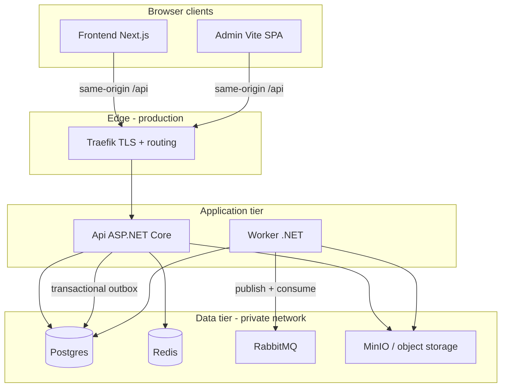

# Infrastructure

**Last updated:** 2026-06-04

Single entry point for **runtime dependencies**, **local vs production stacks**, and **CI/CD tooling**. Application source stays in `src/`; operational assets live in `local/`, `deploy/`, and `tools/`.

**Related hubs:** [`OVERVIEW.md`](./OVERVIEW.md) (codebase map) · [`deploy/README.md`](./deploy/README.md) (operator playbook)

---

## At a glance

| Environment | Compose / assets | Who runs app code |
|-------------|------------------|-------------------|
| **Local dev** | [`local/docker-compose.yml`](../local/docker-compose.yml) | Api + Worker via `dotnet run`; Frontend/Admin via `npm run dev` |
| **Staging / production** | [`deploy/compose/infra.yml`](../deploy/compose/infra.yml) + [`deploy/compose/stack.yml`](../deploy/compose/stack.yml) + Traefik | All services in Docker containers |

```text
                         LOCAL                          PRODUCTION
                         ─────                          ──────────

  Browser ──► Frontend :3000 / Admin :5174     Browser ──► Traefik (TLS)
              │                                           ├── Frontend (app host)
              └── /api proxy ──► Api :7124                ├── Admin (admin host)
                          │                               └── /api ──► Api
                          └── Worker (IDE)                        Worker (private, no public route)

  Dependencies: Postgres, Redis, RabbitMQ,      Shared infra: Postgres, Redis, RabbitMQ,
                MinIO, MailHog, ClamAV,                    MinIO, ClamAV (+ optional observability)
                OpenSearch (dev logging)        App stack: api, worker, frontend, admin, migrate
```

---

## Runtime architecture (production)



**Important boundaries**

- **Api does not HTTP-call Worker.** Async work: domain event → outbox (Postgres) → RabbitMQ → Worker consumers. See [`backend/MESSAGING_AND_WORKER.md`](./backend/MESSAGING_AND_WORKER.md).
- **Worker has no public route** — network isolation + broker/DB credentials only.
- **Browsers** call `/api` on the same host (Next.js proxy in dev, Traefik in production) to avoid CORS.

Traefik routing details: [`deploy/ARCHITECTURE.md`](./deploy/ARCHITECTURE.md).

---

## Service inventory

### Core data & messaging (required for full platform)

| Service | Purpose | Used by |
|---------|---------|---------|
| **PostgreSQL 16** | Primary DB; transactional outbox | Api, Worker, migrate job |
| **Redis 7** | Cache, failed-login tracker, SignalR backplane | Api (when enabled), Worker |
| **RabbitMQ 3.13** | Integration events, email queue, media pipeline | Worker (publisher + consumers); Api writes outbox only |
| **MinIO / S3** | Media uploads, backups, presigned URLs | Api (initiate/complete), Worker (processing) |
| **ClamAV** | Optional virus scan on media upload | Worker (`IMediaScanner`) |

### Email & observability

| Service | Local | Production | Notes |
|---------|-------|------------|-------|
| **SMTP** | MailHog (`:1025`, UI `:8025`) | Real provider (SendGrid, SES, …) | Email flows outbox → RabbitMQ → Worker → SMTP |
| **OpenSearch** | Included in `local/` | Profile `observability` on infra stack | Serilog sink; security disabled internally — protect via Traefik auth in prod |
| **Prometheus + Grafana + Uptime Kuma** | Not in local compose | Profile `monitoring` on infra stack | Grafana/Uptime Kuma exposed via Traefik + basic auth |

### Application tier (production only)

| Service | Public route | Notes |
|---------|--------------|-------|
| **Api** | Yes — `/api/*` on app + admin hosts (and tenant subdomains) | Health: `/health/live`, `/health/ready` |
| **Worker** | **No** | Outbox drain, cron jobs, queue consumers |
| **Frontend** | Yes — app host + tenant subdomains | Same-origin `/api` via Traefik |
| **Admin** | Yes — admin host | Static SPA; API via same-origin `/api` |
| **migrate** | No (one-shot profile `tools`) | Run before rolling out new Api/Worker images |

---

## Local development stack

**Guide:** [`local/README.md`](../local/README.md)

```bash
# From repo root
docker compose -f local/docker-compose.yml up -d
./tools/backend/migrate.sh
dotnet run --project src/Backend/Api
dotnet run --project src/Backend/Worker
```

### Services & ports (host machine)

| Service | Port(s) | Dev UI / credentials |
|---------|---------|----------------------|
| Postgres | 5432 | pgAdmin http://localhost:8080 — `dev@local.dev` / `admin` |
| Redis | 6379 | Redis Commander http://localhost:8081 |
| RabbitMQ | 5672, 15672 | Management UI — `guest` / `guest` |
| MinIO | 9000 (API), 9001 (console) | `minio` / `minio123`; bucket `media` (anonymous-read in dev only) |
| MailHog | 1025 (SMTP), 8025 (UI) | Catch-all inbox in browser |
| ClamAV | 3310 | No UI; first start downloads ~250 MB definitions |
| OpenSearch | 9200 | Dashboards http://localhost:5601 |

**Security warning:** `local/` uses weak default credentials and exposes management ports. **Never reuse in staging or production.**

Point Api/Worker at localhost connection strings — see [`local/README.md`](../local/README.md) and `src/Backend/Api/appsettings.Development.json`.

---

## Production stack

**Guide:** [`deploy/README.md`](./deploy/README.md) → [`deploy/CHECKLIST.md`](./deploy/CHECKLIST.md)

### Compose layout

| File | Stack name | Contents |
|------|------------|----------|
| [`deploy/compose/traefik.yml`](../deploy/compose/traefik.yml) | Edge | TLS termination, routing, Let's Encrypt |
| [`deploy/compose/infra.yml`](../deploy/compose/infra.yml) | `baseproject-infra` | Postgres, Redis, RabbitMQ, MinIO, ClamAV + optional profiles |
| [`deploy/compose/stack.yml`](../deploy/compose/stack.yml) | `baseproject` | Api, Worker, Frontend, Admin, migrate |

Networks: **`proxy`** (public edge) and **`app`** (private service mesh). Worker attaches to **`app` only**.

### Infra profiles (`infra-up.sh`)

| Profile | Services added |
|---------|----------------|
| *(default)* | Postgres, Redis, RabbitMQ, MinIO, ClamAV |
| `observability` | OpenSearch, OpenSearch Dashboards, retention init |
| `monitoring` | Prometheus, Grafana, node/postgres/redis/rabbitmq/cAdvisor/blackbox exporters, Uptime Kuma |

Observability UIs must use Traefik basic auth (`OBSERVABILITY_BASIC_AUTH` in env). Prometheus stays on the private `app` network only.

### Routing (Traefik)

| Host | Traffic |
|------|---------|
| `APP_HOST` | Frontend; `/api/*` → Api |
| `ADMIN_HOST` | Admin SPA; `/api/*` → Api |
| `{tenant}.APP_HOST` | Tenant subdomain → Frontend + `/api` |
| Worker | No Traefik labels — not internet-facing |

Details: [`deploy/ARCHITECTURE.md`](./deploy/ARCHITECTURE.md) · tenant custom domains: [`deploy/TENANT_HOSTING.md`](./deploy/TENANT_HOSTING.md)

### Operator rollout (typical)

```bash
./deploy/scripts/traefik-up.sh <env>
./deploy/scripts/infra-up.sh <env>
./deploy/scripts/build.sh <env>
./deploy/scripts/migrate.sh <env>
IMAGE_TAG=<tag> ./deploy/scripts/up.sh <env>
./deploy/scripts/smoke.sh <env>
```

Env templates: `deploy/env/**/**/*.example` — never commit real secrets. Strategy: [`deploy/ENVIRONMENT_STRATEGY.md`](./deploy/ENVIRONMENT_STRATEGY.md).

### Production prerequisites (non-negotiable)

1. **Migrate before rollout** — `./deploy/scripts/migrate.sh`
2. **DataProtection key ring** — shared volume across all Api replicas + Worker ([`backend/DATA_PROTECTION.md`](./backend/DATA_PROTECTION.md))
3. **Strong secrets** — JWT, DB, Redis, MinIO, webhook HMAC keys via secret manager
4. **`AllowedHosts`** — Api refuses `*` outside Development
5. **Enable RabbitMQ** when using media pipeline, outbox email, or integration events (`Messaging:RabbitMq:Enabled=true`)

Scaling tiers: [`deploy/SCALING.md`](./deploy/SCALING.md).

---

## What each component depends on

| Capability | Minimum | Recommended production |
|------------|---------|------------------------|
| Auth + CRUD API | Postgres | Postgres + Redis (cache) |
| Refresh lockout / rate limits | Redis or in-memory | Redis |
| Media upload + processing | Postgres + MinIO | + RabbitMQ + Worker + ClamAV |
| Transactional email | Postgres + RabbitMQ + Worker | + SMTP credentials |
| SignalR realtime | Postgres | + Redis backplane (`Realtime:Enabled`, multi-replica) |
| Web Push | Postgres + VAPID keys | Same |
| Payment webhooks | Postgres | + provider webhook secrets |
| Structured logs → OpenSearch | OpenSearch reachable | Profile `observability` + retention policy |
| Metrics / uptime | — | Profile `monitoring` |

Messaging architecture: [`backend/MESSAGING_AND_WORKER.md`](./backend/MESSAGING_AND_WORKER.md).

---

## CI/CD infrastructure

Two supported delivery paths (same runtime; different workflow):

| Path | Trigger | Build | Deploy | Doc |
|------|---------|-------|--------|-----|
| **GitHub Actions** | PR + push to `main` | Tests, lint, build on ubuntu-latest | No auto-deploy | [`.github/workflows/ci.yml`](../.github/workflows/ci.yml) |
| **Jenkins (Option 1)** | Manual/param pipeline | Tests → SonarQube → Harbor push | SSH `migrate.sh` + `up.sh` | [`Jenkinsfile`](../Jenkinsfile), [`tools/jenkins/README.md`](../tools/jenkins/README.md) |
| **Manual operator (Option 2)** | Operator scripts | Local `deploy/scripts/build.sh` | Same migrate/up/smoke gates | [`deploy/OPTIONS.md`](./deploy/OPTIONS.md) |

### GitHub Actions jobs

- Admin / Frontend — lint, build, `npm audit`
- Backend — `dotnet build`, unit + integration tests
- Playwright e2e — full stack smoke against running Api
- Migration check (separate workflow) — EF migration drift on PRs

Run CI locally: [`tools/ci/run-ci-local.sh`](../tools/ci/run-ci-local.sh) — see [`tools/ci/README.md`](../tools/ci/README.md).

### Jenkins pipeline stages (summary)

1. Test suite (`tools/ci/run-ci-local.sh`, skippable)
2. Parallel SonarQube — backend, frontend, admin
3. Parallel Docker build + push to Harbor — `api`, `worker`, `migrate`, `frontend`, `admin`
4. SSH deploy to VPS — migrate then rolling `up`
5. HTTPS smoke + email notification

Parameters: `TARGET_ENV`, `PIPELINE_ACTION` (`deploy` | `rollback` | `smoke-only`), `IMAGE_TAG`, skip flags.

---

## Docker images

| Image | Dockerfile | Build context |
|-------|------------|---------------|
| api | `deploy/docker/api/Dockerfile` | repo root |
| worker | `deploy/docker/worker/Dockerfile` | repo root |
| migrate | `deploy/docker/migrate/Dockerfile` | repo root |
| frontend | `deploy/docker/frontend/Dockerfile` | repo root |
| admin | `deploy/docker/admin/Dockerfile` | repo root |

Build entrypoint: `./deploy/scripts/build.sh <env>`.

---

## Managed services alternative

The compose templates target **self-hosted Docker**. For production you can replace individual services with managed equivalents without code changes — only connection strings / env vars:

| Self-hosted | Common managed replacement |
|-------------|----------------------------|
| Postgres in `infra.yml` | RDS, Cloud SQL, Neon, Supabase |
| Redis | ElastiCache, Upstash, Redis Cloud |
| RabbitMQ | CloudAMQP, Amazon MQ |
| MinIO | AWS S3, Cloudflare R2 |
| Traefik on VPS | Cloud load balancer + cert manager |

See [`deploy/SCALING.md`](./deploy/SCALING.md) § managed services.

---

## Further reading

| Topic | Document |
|-------|----------|
| Runtime topology & security baseline | [`deploy/ARCHITECTURE.md`](./deploy/ARCHITECTURE.md) |
| Pre/post deploy checklist | [`deploy/CHECKLIST.md`](./deploy/CHECKLIST.md) |
| Env file layout | [`deploy/ENVIRONMENT_STRATEGY.md`](./deploy/ENVIRONMENT_STRATEGY.md) |
| Api / Worker / outbox / RabbitMQ | [`backend/MESSAGING_AND_WORKER.md`](./backend/MESSAGING_AND_WORKER.md) |
| DataProtection keys (2FA) | [`backend/DATA_PROTECTION.md`](./backend/DATA_PROTECTION.md) |
| Production readiness gaps | [`backend/PRODUCTION_READINESS_REPORT.md`](./backend/PRODUCTION_READINESS_REPORT.md) |
| Platform infra already built (Klassi Phase 0) | [`business/FEATURE_ROADMAP.md`](./business/FEATURE_ROADMAP.md) § Platform Infrastructure |
| OpenSearch retention (local) | [`local/opensearch/README.md`](../local/opensearch/README.md) |
