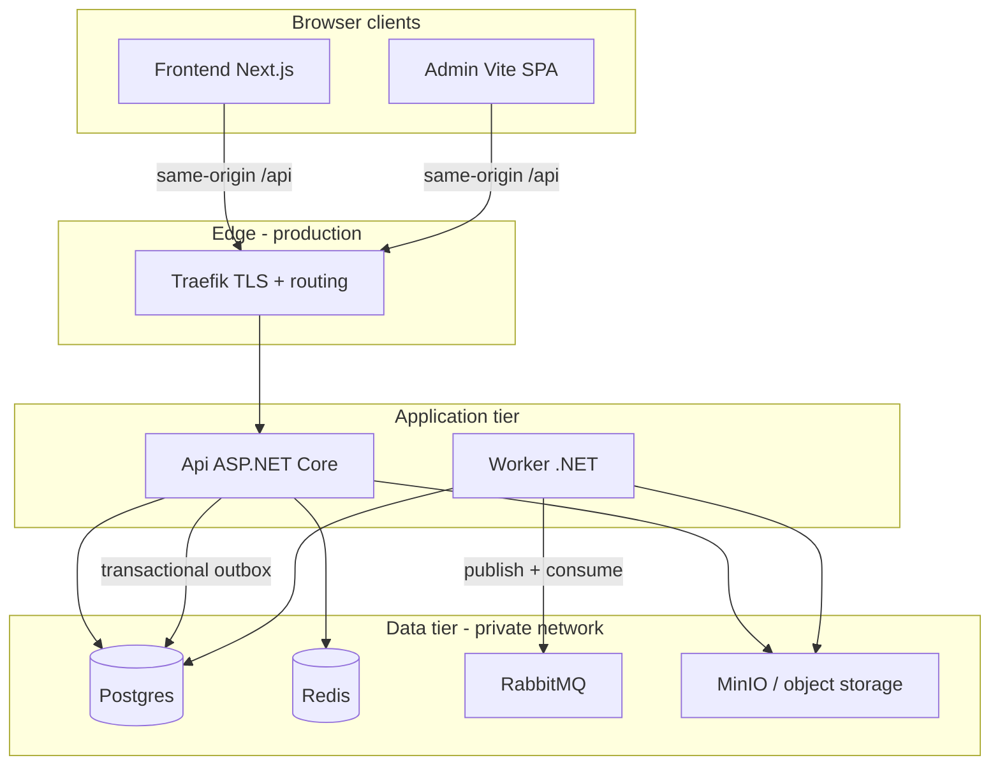

# Codebase overview

Single entry point for understanding this monorepo: what it contains, how pieces connect, and **what “production-ready” actually means here**.

**Last updated:** 2026-06-01

---

## What this repository is

| Path | Role |
|------|------|
| [`src/Backend/`](../src/Backend/) | .NET 8 API + Application + Domain + Infrastructure + **Worker** (background jobs, outbox, queue consumers) |
| [`src/Frontend/`](../src/Frontend/) | Next.js 15 end-user app |
| [`src/Admin/`](../src/Admin/) | Vite + React internal admin console |
| [`local/`](../local/) | Docker Compose for **local dependencies only** (Postgres, Redis, RabbitMQ, MinIO, …) |
| [`deploy/`](../deploy/) | Production-oriented Dockerfiles, compose stacks, env templates, scripts |
| [`e2e/`](../e2e/) | Playwright UI tests + helpers |
| [`tools/`](../tools/) | Migrate / test wrapper scripts |
| [`docs/`](../docs/) | Human handbook (this tree) |

Application code lives under `src/`. `deploy/` and `local/` are operational layers, not duplicate app logic.

---

## Runtime architecture



**Important boundaries**

- **Api does not HTTP-call Worker.** Async work flows: domain event → outbox → RabbitMQ → Worker consumers. See [`backend/MESSAGING_AND_WORKER.md`](./backend/MESSAGING_AND_WORKER.md).
- **Worker has no public route** in deploy compose. Security = network isolation + broker/DB credentials.
- **Browsers** should call `/api` on the same host (dev proxy or Traefik) to avoid CORS complexity.

Detailed deploy topology: [`deploy/ARCHITECTURE.md`](./deploy/ARCHITECTURE.md).

---

## Is the code “production-ready” and security-solid?

**Short answer:** The **architecture and security baseline are solid** for a controlled production launch (moderate traffic, single-tenant or few tenants). It is **not** “turn key and forget” — operators must complete the deploy checklist, secrets, and infra enablement.

| Claim | Accurate? | Notes |
|-------|-----------|-------|
| Clean layered backend (DDD-ish) | Yes | Api thin; Application handlers; Infrastructure adapters; Worker separate |
| Security-conscious API defaults | Yes | HSTS, security headers, JWT, admin policy, rate limits, `AllowedHosts` fail-fast outside Development |
| Reliable async pipeline | Yes (when configured) | Transactional outbox, RabbitMQ, idempotent consumers |
| Ready for massive realtime / push | **Partial** | SignalR hub + `SignalRNotificationDispatcher` implemented; enable `Realtime:Enabled=true` + Redis backplane for multi-replica scale |
| Ready for large-scale search | **No** | Admin user search is SQL; product search not implemented |
| Secure if you only `docker compose up` local | **No** | `local/` uses dev credentials by design — **local only** |

**Verdict (aligned with [`backend/PRODUCTION_READINESS_REPORT.md`](./backend/PRODUCTION_READINESS_REPORT.md)):**

> **Production-viable baseline** — suitable for staging/production when [`deploy/CHECKLIST.md`](./deploy/CHECKLIST.md) is followed and secrets/infra are set correctly. Not yet a full enterprise SaaS platform without follow-up work (search, notification scale, multi-tenant flags).

---

## Security baseline (what is already in code)

These are implemented in the API host (see `src/Backend/Api/Program.cs` and related middleware):

| Control | Behavior |
|---------|----------|
| **Host header** | Refuses to start in non-Development if `AllowedHosts` is `*` |
| **HSTS** | Enabled outside Development (configurable `Hsts:*`) |
| **Forwarded headers** | Configurable trusted proxies/networks for correct client IP behind Traefik |
| **Kestrel** | `Server` header removed |
| **Auth** | JWT bearer; admin-only routes via policy + MediatR guards |
| **Idempotency** | `Idempotency-Key` on register, media complete, admin mutations |
| **Concurrency** | Optimistic `RowVersion` → HTTP 409 on conflict |
| **Data Protection** | Encrypts 2FA secrets at rest; **requires persistent key ring in production** — [`backend/DATA_PROTECTION.md`](./backend/DATA_PROTECTION.md) |
| **Rate limiting** | Auth and media endpoints |
| **Webhook signatures** | Stripe, VNPay, PayOS HMAC-SHA256 verified on receipt; gated on secret presence |
| **Transactional mutations** | Billing, Tenancy, and Notification mark-read endpoints wrapped in `[Transactional]` |

**Operator responsibilities (not automatic):**

- Set strong `JwtSettings:Secret`, DB passwords, MinIO keys via secret manager — never commit real `.env`
- Configure `AllowedHosts`, `ReverseProxy:KnownProxies` / `KnownNetworks` for your edge
- Persist `DataProtection:KeysDirectory` (shared across all Api replicas + Worker)
- Disable or protect Swagger in production (`Swagger:ExposeInProduction`)
- Change or disable dev admin seed in production (`Seed:Admin`)
- Enable RabbitMQ + Redis when you need media pipeline / distributed cache / SignalR backplane
- Set `SMTP__*`, `Stripe__WebhookSecret`, `VnPay__WebhookSecret`, `PayOs__WebhookSecret` in production env (see `deploy/env/**/app.env.example`)

Deploy rules: [`deploy/README.md`](./deploy/README.md), checklist: [`deploy/CHECKLIST.md`](./deploy/CHECKLIST.md).

---

## Local development vs production

| Aspect | Local (`local/`) | Production (`deploy/`) |
|--------|------------------|------------------------|
| Purpose | Fast iteration from IDE | Scripted Docker + Traefik rollout |
| Credentials | Weak, documented dev values | From `deploy/env/**/*.example` → real secrets on server |
| Api + Worker | Run via `dotnet run` | Separate containers in `stack.yml` |
| TLS | Dev certs / HTTP | Traefik termination |
| Migrations | `./tools/backend/migrate.sh` | `./deploy/scripts/migrate.sh` |

**Do not** reuse `local/docker-compose.yml` passwords or MinIO policies outside local machines.

---

## Standard dev credentials (Development only)

When admin seeding is enabled, use the values from `src/Backend/Api/appsettings.Development.json`:

| Field | Value |
|-------|-------|
| Email | `admin@localhost.com` |
| Password | `Temp!ChangeMe123` |

Override via `Seed:Admin` in configuration. **Change or disable before any shared/staging/production environment.**

---

## Test strategy

| Layer | Tool | Doc |
|-------|------|-----|
| Backend unit + integration | `dotnet test` | [`test/ONBOARDING.md`](./test/ONBOARDING.md) |
| UI e2e | Playwright under `e2e/` | [`e2e/README.md`](../e2e/README.md) |
| Deploy smoke | `deploy/scripts/smoke.sh` | [`deploy/CHECKLIST.md`](./deploy/CHECKLIST.md) |

---

## Recommended reading order

### Everyone (30 min)

1. This file
2. Root [`README.md`](../README.md)
3. Role-specific onboarding below

### By role

| Role | Start here |
|------|------------|
| Backend | [`backend/ONBOARDING.md`](./backend/ONBOARDING.md) → [`backend/ARCHITECTURE.md`](./backend/ARCHITECTURE.md) |
| Frontend | [`frontend/ONBOARDING.md`](./frontend/ONBOARDING.md) |
| Admin | [`admin/ONBOARDING.md`](./admin/ONBOARDING.md) |
| QA / test | [`test/ONBOARDING.md`](./test/ONBOARDING.md) |
| DevOps / deploy | [`deploy/README.md`](./deploy/README.md) → [`deploy/ARCHITECTURE.md`](./deploy/ARCHITECTURE.md) → [`deploy/CHECKLIST.md`](./deploy/CHECKLIST.md) |
| Tech lead / PM | [`backend/FEATURE_CATALOG.md`](./backend/FEATURE_CATALOG.md) + [`backend/PRODUCTION_READINESS_REPORT.md`](./backend/PRODUCTION_READINESS_REPORT.md) |

---

## Known gaps (honest backlog)

Tracked in detail in [`backend/PRODUCTION_READINESS_REPORT.md`](./backend/PRODUCTION_READINESS_REPORT.md) and [`backend/EXTENSIBILITY_AND_GAPS.md`](./backend/EXTENSIBILITY_AND_GAPS.md). Highlights:

- Product full-text search (OpenSearch/Elasticsearch) — feasible via outbox, not built
- Realtime notifications (SignalR) — **implemented**; `Realtime:Enabled=true` + Redis backplane required for multi-instance scale; Worker cron only delivers when a real dispatcher is present (`IsRealtime` guard)
- Email — **outboxed via `OutboxQueuingEmailSender` → RabbitMQ → `EmailSendConsumerService`**; SMTP credentials required in production
- Payment webhooks (VNPay/PayOS) — HMAC-SHA256 signature verification implemented; validate against provider sandbox before live traffic
- Multi-tenant feature flags and settings — reserved for future
- High-traffic: load-test outbox publisher, consider persistent Quartz store for multi-pod Worker

---

## Quick start (local)

```bash
# From repo root
docker compose -f local/docker-compose.yml up -d
./tools/backend/migrate.sh
dotnet run --project src/Backend/Api
dotnet run --project src/Backend/Worker
cd src/Frontend && npm install && npm run dev
cd src/Admin && npm install && npm run dev
```

- Frontend: http://localhost:3000  
- Admin: http://localhost:5174  
- API health: `https://localhost:7124/health/ready` (or your configured port)
