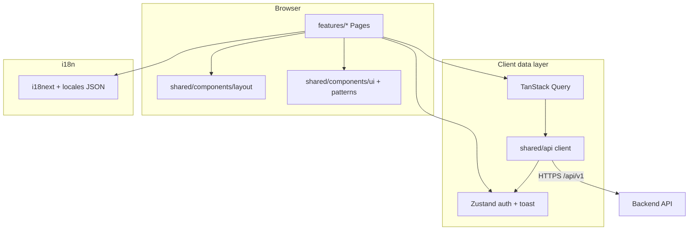

# Admin architecture

High-level design of the Admin Console SPA and how it talks to the backend.

---

## Layer diagram



---

## Folder responsibilities

| Path | Responsibility |
|------|----------------|
| `app/App.tsx` | Root component |
| `app/router.tsx` | Route table, `ProtectedRoute` wrapper |
| `app/providers.tsx` | `QueryClient`, auth hydrate, `Toaster` |
| `config/env.ts` | `API_V1` base path |
| `features/<name>/` | Screens: pages, feature-only dialogs |
| `shared/api/client.ts` | Fetch, JWT attach, refresh, envelope parse |
| `shared/api/admin-api.ts` | Typed admin endpoints |
| `shared/api/auth-api.ts` | Login / 2FA |
| `shared/types/api.ts` | DTO types mirroring backend |
| `shared/stores/auth-store.ts` | Session + hydrate from storage |
| `shared/lib/*` | Pure helpers (no React) |
| `shared/hooks/*` | Reusable React hooks |
| `shared/constants/*` | Query keys, CSS class strings |
| `i18n/*` | Locale files + `setAppLocale` |

**Rule:** `features/` may import from `shared/` and `i18n/`. `shared/` must **not** import from `features/`.

---

## Request / auth flow

1. User submits login → `auth-api` → `ApiResponse<AuthResponseDto>`.
2. `auth-store.setSession` keeps access token in memory, refresh in `sessionStorage`.
3. `apiRequest` attaches `Authorization: Bearer` unless `anonymous: true`.
4. On 401, client attempts refresh once, then clears session.
5. `ProtectedRoute` redirects to `/login` with `state.from` for return URL.

Mutating admin calls set `Idempotency-Key` when `idempotent: true` in `admin-api` helpers.

---

## Server state (TanStack Query)

- **Queries:** list/detail/metrics — keyed via `queryKeys` (see [`COMMON_LIBRARIES.md`](./COMMON_LIBRARIES.md)).
- **Mutations:** create/update/actions — `onSuccess` invalidates related keys + `toast.success`.
- **Defaults** (`providers.tsx`): `staleTime: 30s`, `retry: 1` on queries.

Avoid fetching in `useEffect` when Query can own the lifecycle.

---

## UI composition patterns

Typical page structure:

```tsx
<>
  <PageHeader title={t('...')} description={t('...')} actions={...} />
  <PageContent>
    {error ? <Alert /> : null}
    <Card>...</Card>
  </PageContent>
</>
```

- **Layout:** `AdminLayout` = sidebar + mobile header + `<Outlet />`.
- **Tables:** overflow-x-auto wrapper; pagination via `DataTablePagination`.
- **Destructive actions:** `confirmAction(t('...'))` then mutation.

---

## Styling

- **Tailwind CSS 4** via `@tailwindcss/vite`.
- Design tokens in `index.css` (`--color-surface`, `--color-accent`, …).
- Class merge: `cn()` from `shared/lib/cn`.
- Form selects: `formSelectClass` from `shared/constants/styles`.

No separate CSS-in-JS library.

---

## Error handling

| Source | Handling |
|--------|----------|
| API envelope failure | `ApiClientError` thrown from `client.ts` |
| Concurrency | Code `ConcurrencyConflict` → translated toast in `getApiErrorMessage` |
| Form validation | Zod + `firstZodError` |
| Inline page errors | `Alert` or toast |

Do not swallow errors silently except where UX explicitly allows (e.g. optional peek).

---

## Build & deploy

- **Dev:** Vite dev server port 5174, proxies `/api` to `VITE_API_PROXY_TARGET`.
- **Prod:** `npm run build` → static assets; serve behind reverse proxy.
- Set `VITE_API_BASE_URL` if API is on another origin.

Admin has no SSR — SEO not applicable.

---

## Alignment with backend

| Concern | Backend doc |
|---------|-------------|
| Admin API contracts | Swagger `/swagger`, controllers under `Api/Controllers/Admin/` |
| Row version on writes | [`OPTIMISTIC_CONCURRENCY.md`](../backend/OPTIMISTIC_CONCURRENCY.md) |
| Audit actions logged | Backend audit module |
| DLQ | RabbitMQ + admin messaging endpoints |

When backend adds endpoints, mirror DTOs in `shared/types/api.ts` and functions in `admin-api.ts`.
