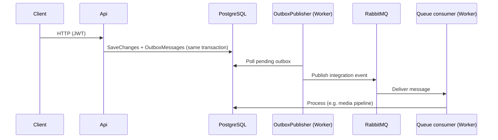

# Messaging, outbox, and Worker host

How **Api** and **Worker** cooperate without HTTP calls between them.

---

## Mental model

| Question | Answer |
|----------|--------|
| Does Api call Worker over HTTP? | **No.** |
| How does work reach Worker? | **PostgreSQL** (outbox + business tables) and optionally **RabbitMQ** (queues). |
| Does Worker need JWT / user auth? | **No.** Worker is not a public API; it uses **infrastructure credentials** (DB, broker). |
| Who authenticates end users? | **Api only** (JWT Bearer, policies). |

---

## Host registration (do not mix up)

| Host | Infrastructure | Outbox drain | HTTP auth |
|------|----------------|--------------|-----------|
| **Api** | `AddInfrastructure()` — JWT + `HttpContextLoggedInUserService` | **Must NOT** register `AddOutboxPublisher` | Yes |
| **Worker** | `AddInfrastructureCore()` — `NullLoggedInUserService` | **`AddOutboxPublisher`** in `Worker/Program.cs` | No controllers |

Registering the outbox publisher on **both** hosts would **double-publish** messages.

---

## Transactional outbox

### Producing (Api / any write host)

1. Aggregate raises `IIntegrationEvent` (e.g. `MediaAssetUploadedDomainEvent`, routing key `media.uploaded.v1`).
2. `DomainEventsSaveChangesInterceptor` serializes the event into **`OutboxMessages`** during `SaveChanges`.
3. Business row and outbox row commit in the **same transaction**.

### Draining (Worker only)

`OutboxPublisherHostedService`:

- Polls `OutboxMessages` with `FOR UPDATE SKIP LOCKED` (safe for multiple publisher instances).
- Publishes JSON via `IMessagePublisher.PublishRawAsync` → RabbitMQ when enabled.
- On failure: exponential backoff; after `MaxAttempts` → row marked **abandoned**.

### Configuration (`Outbox` section — code defaults if omitted from JSON)

| Key | Default | Notes |
|-----|---------|-------|
| `Enabled` | `true` | Set `false` to disable publisher in Worker |
| `PollIntervalSeconds` | `5` | Idle delay when queue empty |
| `BatchSize` | `50` | Rows per cycle |
| `MaxAttempts` | `10` | Then abandoned |
| `InitialBackoffSeconds` | `10` | Exponential cap 1 hour |

### Rules

- Consumers must be **idempotent** on `EventId` (at-least-once delivery).
- Prefer **one event type** per cross-process need: `IIntegrationEvent` **or** in-process `ITransactionalDomainEvent` / `IAfterCommitDomainEvent`, not both on the same class unless you intentionally raise two events.

See also **`DEVELOPER_GUIDE.md`** §3c.

---

## RabbitMQ

Config: `Messaging:RabbitMq` in `appsettings`.

| Key | Local default | Notes |
|-----|---------------|-------|
| `Enabled` | **`false`** | Api + Worker use `NullMessagePublisher` / `NullMessageConsumer` |
| `Host` / `Port` | `localhost` / `5672` | Docker: `local/docker-compose.yml` |
| `DefaultExchange` | `finalproject.events` | Topic exchange |

When `Enabled: false`:

- Outbox rows still accumulate in Postgres.
- Publisher logs “would publish” and marks processed (no real broker traffic).
- **Media pipeline does not run** via queue until Rabbit is enabled and Worker consumer is running.

### Enable locally (media end-to-end)

1. `docker compose -f local/docker-compose.yml up -d rabbitmq`
2. Set `Messaging:RabbitMq:Enabled: true` in **both** `Api/appsettings.Development.json` and `Worker/appsettings.Development.json` (or user-secrets).
3. Run **Worker** + **Api**.
4. Upload + complete media → outbox → Rabbit → `MediaProcessingConsumerService` (`media.uploaded.v1`).

Management UI: http://localhost:15672 (`guest` / `guest`).

### Admin DLQ tools

When Rabbit is enabled, admins can inspect dead-letter queues:

- `GET api/v1/admin/messaging/dlq/{queueName}/peek`
- `POST .../replay`, `POST .../drain`

Requires **AdminOnly** policy (JWT on Api only).

---

## Worker triggers (three shapes)

| Pattern | Type | Example |
|---------|------|---------|
| **Cron** | `ICronJob` + `AddWorkerScheduling()` | `StaleMediaRecoveryJob`, `OutboxCleanupJob`, `MediaStorageCleanupJob` |
| **Queue** | `QueueConsumerBackgroundService<TMessage>` | `MediaProcessingConsumerService` |
| **Loop** | `BackgroundService` | `SampleBackgroundService` (samples only) |

### Production cron jobs (always registered)

| Job | Config cron key | Default expression | Purpose |
|-----|-----------------|-------------------|---------|
| `StaleMediaRecoveryJob` | `StaleMediaRecoveryCronExpression` | `*/5 * * * *` | Re-queue stuck media processing |
| `MediaStorageCleanupJob` | `MediaStorageCleanupCronExpression` | `0 3 * * *` | Orphan object cleanup (gated by `EnableMediaStorageCleanup`) |
| `OutboxCleanupJob` | `OutboxCleanupCronExpression` | `30 2 * * *` | Delete old processed/abandoned outbox rows |

### Scheduling engine

- Default: **Quartz.NET** (`Worker:UseQuartzScheduler: true`).
- Fallback: in-process **Cronos** (`UseQuartzScheduler: false`).
- Clustered cron: `Worker:Quartz:UsePersistentStore: true` + shared Postgres.

Cron expressions in config are **5-field** (minute hour dom month dow); infrastructure normalizes to Quartz **6-field** (seconds first).

### Sample scaffolding (off by default)

- `Worker:EnableSamples: true` → `SampleCronJob`, `SampleQueueConsumerService`
- `Worker:EnableSampleBackgroundLoop: true` → `SampleBackgroundService`

---

## Security boundaries

| Layer | Mechanism |
|-------|-----------|
| **Public API** | JWT, `[Authorize]`, `AuthorizationPolicies.AdminOnly`, rate limiting on auth |
| **Worker process** | No HTTP surface; trust **private network** + DB/broker credentials |
| **RabbitMQ** | Broker username/password — not end-user JWT |
| **Postgres** | Connection string — shared by Api and Worker |

**Do not** add `[Authorize]` to Worker “for consistency” — there is no user context. Protect Worker deployment (network policy, secrets manager).

---

## Adding a new integration event

1. `record MyEvent : IIntegrationEvent` with `EventId`, `OccurredOnUtc`, `RoutingKey`.
2. `aggregate.AddDomainEvent(new MyEvent(...))` before save.
3. Worker: `QueueConsumerBackgroundService<MyMessage>` with queue name matching routing key (or shared subscription pattern).
4. Handler: idempotent on `EventId`; use **scoped** `IServiceScopeFactory` per message if using EF.
5. Document in **`FEATURE_CATALOG.md`** and **`MESSAGING_AND_WORKER.md`** (this file).

---

## Troubleshooting

| Symptom | Likely cause |
|---------|----------------|
| Outbox rows never drain | Worker not running, or `Outbox:Enabled: false` |
| Outbox drains but media stuck | `RabbitMq:Enabled: false` or consumer not running |
| `NpgsqlRetryingExecutionStrategy` + transaction error | Explicit transaction without execution strategy — see `TransactionalActionFilter` / outbox publisher (already wrapped) |
| Duplicate processing | Missing idempotency on consumer `EventId` |

---

## Related docs

- [`DEVELOPER_GUIDE.md`](./DEVELOPER_GUIDE.md) — outbox §3c, worker §4–7
- [`DATA_PROTECTION.md`](./DATA_PROTECTION.md) — shared keys between Api and Worker (2FA columns)
- [`EF_PITFALLS.md`](./EF_PITFALLS.md) — LINQ in repositories
- [`FEATURE_CATALOG.md`](./FEATURE_CATALOG.md) — HTTP endpoints
