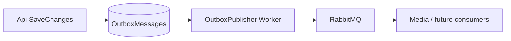

# Production Readiness & Scalability Report

**Date:** 2026-06-01 (summary also in [`../OVERVIEW.md`](../OVERVIEW.md))  
**Scope:** `src/Backend` (Api + Worker + Infrastructure)  
**Verdict:** **Production-viable baseline with clear scale paths** — suitable for controlled launch; several items remain for high-traffic / multi-tenant production.

---

## Executive summary

| Area | Status | Notes |
|------|--------|-------|
| Idempotency (HTTP) | **Ready** | `Idempotency-Key` on register, media complete, admin mutations |
| Feature flags | **Ready (framework)** | Config + DB + env + % rollout; extend keys as needed |
| Admin impersonation | **Ready** | JWT `impersonator_sub`, guards, audit; read claim in API layer |
| Optimistic locking | **Ready** | `RowVersion` on `User`, `MediaAsset`; 409 on conflict |
| Notifications / SignalR | **Partial** | Email outboxed; SignalR hub + dispatcher implemented; realtime delivery guard in place; Redis backplane required for multi-replica |
| Search (Elasticsearch) | **Not implemented** | **Feasible** via existing outbox/Rabbit pattern |
| Horizontal scale | **Ready (core)** | Api/Worker split, outbox, RabbitMQ, Redis hooks |

---

## 1. Idempotency keys

### Implemented

- Header: `Idempotency-Key` (required on marked endpoints).
- Replay header: `Idempotent-Replay: true` when returning a cached success response.
- Storage: `IdempotencyRecords` table (scope + owner partition + key, unique index).
- TTL: configurable via `Idempotency:RetentionHours` / `InProgressTimeoutMinutes`.

### Endpoints protected

| Scope | Endpoint |
|-------|----------|
| `auth.register` | `POST /api/v1/auth/register` |
| `media.complete` | `POST /api/v1/media/{id}/complete` |
| `admin.users.*` | Admin create/update/delete/lock/unlock/impersonate/2fa/password |

### Pre-existing domain idempotency (unchanged)

- Media complete: status guard (`Pending` only raises integration event).
- Media worker: skips non-`Uploaded`/`Failed` assets.
- Outbox: stable `EventId` for downstream consumers.

### Gaps / ops notes

- Run migration `AddIdempotencyAndRowVersion` before deploy.
- Periodic cleanup job for expired idempotency rows (optional; rows expire logically on read).
- Register race: unique indexes on `NormalizedEmail` / `NormalizedUserName` remain the last line of defense; idempotency prevents most double-submit cases.

---

## 2. Feature flag framework

### Implemented (`IFeatureFlagService`)

Evaluation order:

1. **Database** — when `DbKey` is set (e.g. `feature.auth.allow_public_register` via `AppSettings`).
2. **Environment** — `FeatureFlags:Flags:{key}:Environments:{EnvironmentName}`.
3. **Canary** — `Percentage` (0–100) with stable hash on `UserId` (+ optional `TenantId`).
4. **Default** — `FeatureFlags:Flags:{key}:Default`.

Example (`appsettings.json`):

```json
"FeatureFlags": {
  "Flags": {
    "auth.allow_public_register": {
      "Default": true,
      "DbKey": "feature.auth.allow_public_register"
    }
  }
}
```

### Gaps

- No external provider (LaunchDarkly / Unleash) — add adapter behind `IFeatureFlagService` if needed.
- No multi-tenant flag store yet (`TenantId` in context is reserved for future use).
- Admin UI for arbitrary flags: still single-key settings endpoint; extend as product grows.

---

## 3. Admin impersonation

### Implemented

- `POST /api/v1/admin/users/{id}/impersonate` → JWT for target user + `impersonator_sub` claim.
- `ILoggedInUserService.ImpersonatorUserId` / `IsImpersonating`.
- `ApiControllerBase.CurrentImpersonatorId` for controllers.
- Guards: no self-impersonation, no admin targets, `CanSignIn` required.
- Audit: `user.impersonated`.

### Gaps

- No dedicated “exit impersonation” endpoint (client re-authenticates as admin).
- No shorter token TTL for impersonation sessions (same JWT lifetime as normal login).
- Sensitive actions under impersonation: consider extra logging using `ImpersonatorUserId` (hook in behaviors).

---

## 4. Optimistic concurrency (row version)

### Implemented

- `uint RowVersion` on `User` and `MediaAsset` (EF `IsRowVersion()`).
- `ConcurrencyConflictException` → HTTP **409** with `ConcurrencyConflict` error type.

### Usage

Clients should reload entity after 409 and retry. Optional future: expose `RowVersion` in DTOs + `If-Match` header.

### Gaps

- Not on every aggregate (`AppSetting`, `OutboxMessage`, etc.) — add when concurrent admin edits become common.
- No pessimistic `SELECT FOR UPDATE` on HTTP paths (only outbox worker uses `SKIP LOCKED`).

---

## 5. Notifications & realtime — scale assessment

### What scales today



| Component | Scale mechanism |
|-----------|-----------------|
| **Transactional outbox** | `FOR UPDATE SKIP LOCKED` — safe N publisher instances |
| **RabbitMQ** | Competing consumers, DLQ, admin replay API |
| **Email (SMTP)** | **Outboxed** — `OutboxQueuingEmailSender` → RabbitMQ → `EmailSendConsumerService`; SMTP credentials required |
| **Redis cache** | Distributed cache + optional SignalR backplane |
| **Read replica** | `DatabaseReadConnectionString` wired |

### What does not scale yet (product notifications)

| Component | State |
|-----------|--------|
| **SignalR** | `Realtime:Enabled` configurable; `SignalRNotificationDispatcher` implemented; `INotificationDispatcher.IsRealtime` guard prevents false delivery marking on Worker; Redis backplane required for multi-replica |
| **Push notifications** | Not implemented |
| **Email outbox** | **Implemented** — `OutboxQueuingEmailSender` + `EmailSendConsumerService`; Worker resolves `SmtpEmailSender` directly |
| **Payment webhooks** | VNPay + PayOS HMAC-SHA256 via `HmacWebhookSignatureVerifier`; Stripe uses `StripeWebhookSignatureVerifier`; all gated on secret presence |
| **Unified notification bus** | Only `media.uploaded.v1` integration event |

### Recommendation before high notification volume

1. Add integration events (`user.registered.v1`, `media.ready.v1`) → dedicated notification worker.
2. Enable `Realtime:Enabled=true` + Redis backplane (`Realtime:UseRedisBackplane=true`).
3. Validate VNPay/PayOS signature format against provider sandbox before live payment traffic.

**Scale verdict:** **Email + async pipeline are production-grade; realtime push requires Redis backplane at scale.**

---

## 6. Search — Elasticsearch / OpenSearch feasibility

### Current state

- **No** product search layer (`ISearchClient`, indexing).
- Admin user list: PostgreSQL `Contains` on normalized columns (will not scale on large tables).
- OpenSearch appears only as **Serilog log sink** (observability, not search API).

### Feasibility: **High** (greenfield add, no architectural blocker)

| Integration point | Use case |
|-------------------|----------|
| `IIntegrationEvent` → Rabbit consumer | Index/update/delete documents on domain events |
| `IAfterCommitDomainEvent` | Low-latency index (in-process; less durable) |
| `Application/Contracts` + `Infrastructure` impl | `ISearchIndexer` / `ISearchQuery` (mirror `IMessagePublisher` null pattern for local dev) |
| Worker host | New consumer service alongside media pipeline |

Requirements for production search:

- Idempotent upsert by document id (at-least-once delivery).
- Backfill job from Postgres on first deploy.
- Index lifecycle (mappings, reindex).

**No implementation required now** — existing outbox + worker model is the correct extension surface.

---

## 7. Overall scalability & production checklist

### Strengths (ready)

- [x] Api / Worker process split
- [x] CQRS read/write DbContext
- [x] Transactional outbox + RabbitMQ
- [x] Object storage for media blobs
- [x] Rate limiting (auth, media)
- [x] Health checks (db, redis, rabbit, storage, smtp)
- [x] OpenTelemetry + structured logging
- [x] Security baseline (HSTS, CSP, CORS allowlists, JWT, admin policy + MediatR `IRequireAdmin`)
- [x] Idempotency + concurrency controls (this release)

### Before high-traffic production

- [ ] Set `AllowedHosts`, JWT secrets, DataProtection `KeysDirectory` (non-ephemeral)
- [ ] Apply DB migrations (including `AddIdempotencyAndRowVersion`)
- [ ] Enable RabbitMQ + Redis in target environment
- [ ] Configure read replica connection string if used
- [ ] Worker: `Worker:Quartz:UsePersistentStore` for multi-pod cron (avoid duplicate jobs)
- [ ] Load-test outbox publisher + Rabbit channel pool (single channel today — noted in code)
- [ ] Add FTS or Elasticsearch before large admin user search
- [ ] Notification outbox if email/push volume grows

### Multi-tenant / enterprise (future)

- [ ] `ITenantContext` + tenant-scoped `AppSettings` / feature flags
- [ ] Per-tenant index partitions in search cluster

---

## 8. Files touched (reference)

| Concern | Key paths |
|---------|-----------|
| Idempotency | `Api/Filters/IdempotencyActionFilter.cs`, `Infrastructure/Idempotency/` |
| Feature flags | `Application/Contracts/FeatureFlags/`, `Infrastructure/FeatureFlags/` |
| Impersonation | `ImpersonateUserCommand.cs`, `ILoggedInUserService`, `HttpContextLoggedInUserService` |
| Concurrency | `User.cs`, `MediaAsset.cs`, `EfUnitOfWork.cs`, `ConcurrencyConflictError` |
| Migration | `Persistence/Migrations/*AddIdempotencyAndRowVersion*` |

---

## Conclusion

The codebase is **ready for a production baseline deployment** with realistic traffic: auth, media pipeline, admin operations, and async workers are architected for reliability and horizontal scaling.

**Not yet ready** for: massive realtime notification fan-out, full-text search at scale, or multi-tenant SaaS without the follow-ups above.

Elasticsearch/OpenSearch for product search is **recommended and feasible** when needed — integrate via outbox events, not a rewrite.
