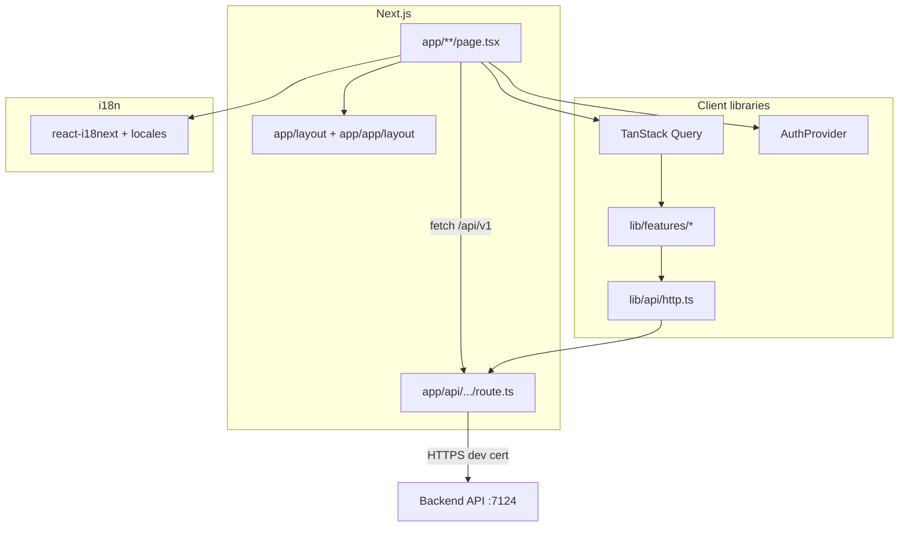

# Frontend architecture

High-level design of the Next.js end-user app and how it talks to the backend.

---

## Layer diagram

---

## Folder responsibilities

| Path | Responsibility |
|------|----------------|
| `app/layout.tsx` | Root HTML, cookie locale, `Providers` |
| `app/providers.tsx` | QueryClient, I18n, AuthProvider |
| `app/api/[...path]/route.ts` | Dev/prod API reverse proxy (TLS to backend) |
| `app/page.tsx` | Public landing |
| `app/login`, `register`, … | Auth flows (public) |
| `app/app/*` | Authenticated shell (`RequireAuth`) |
| `components/ui/` | Button, Input — no domain logic |
| `components/layout/` | PublicHeader, LanguageSwitcher |
| `components/auth/` | GoogleSignIn, QrCode |
| `components/i18n/` | LocaleSync (post-hydration preference) |
| `lib/api/http.ts` | `apiRequest`, `apiRaw`, refresh, envelope |
| `lib/api/types.ts` | `ApiResponse<T>`, `ApiErrorPayload` |
| `lib/features/<domain>/` | Typed API functions per domain |
| `lib/auth/` | Tokens (localStorage), context, guard |
| `lib/shared/` | Format, display, pagination, validation helpers |
| `i18n/locales/*.json` | en / vi / zh strings |
| `i18n/config.ts` | i18next init, `setAppLocale`, cookie sync |

**Rules:**

- `app/*` and `components/*` may import `lib/*`, `i18n/*`.
- `lib/features/*` may import `lib/api/*`, `lib/errors` — not React pages.
- `lib/shared/*` must **not** import from `app/*` or `components/*`.

---

## Request / auth flow

1. Login → `authApi.login` → `apiRaw` (handles HTTP **202** for 2FA).
2. `AuthProvider.setSession` → `localStorage` tokens + user snapshot from auth response.
3. On load / refresh: hydrate user via `GET /users/profile` if token exists.
4. `apiRequest` with `auth: true` attaches `Authorization: Bearer`.
5. On **401**, client attempts one `refresh`, then clears session.
6. `RequireAuth` redirects to `/login?next=...` when unauthenticated.

**Token storage:** access + refresh in `localStorage` (`lib/auth/tokens.ts`). Acceptable for SPA base; consider httpOnly cookies for hardened production.

---

## API proxy (why it exists)

| Approach | Dev experience |
|----------|----------------|
| Browser → `https://localhost:7124` | CORS + self-signed TLS pain |
| Browser → `/api` → Next proxy → backend | Same-origin; proxy uses `rejectUnauthorized: false` in dev |

Configure target: `API_PROXY_TARGET` (default `https://localhost:7124`).

---

## Server state (TanStack Query)

- Profile, 2FA status: `useQuery` with keys like `["me", "profile"]`.
- Mutations: `useMutation` + `invalidateQueries` on success.
- Defaults (`providers.tsx`): `retry: 1`, no refetch on window focus.

Prefer Query over `useEffect` + `fetch` for server data.

---

## i18n + SSR

- Server reads locale **cookie** → `<html lang="...">` matches first paint.
- Client `LocaleSync` applies `localStorage` / browser preference after hydrate if different.
- All new UI strings: **en + vi + zh** together.

---

## SEO

- Public routes (`/`, `/login`) are Server Components where possible.
- Authenticated `/app/*` is mostly client components (auth state).
- Customize `metadata` in `app/layout.tsx` per product.

---

## Comparison with Admin

| Topic | Admin (Vite) | Frontend (Next) |
|-------|--------------|-----------------|
| Routing | react-router | App Router file-based |
| API proxy | Vite `server.proxy` | `app/api/[...path]/route.ts` |
| Token | sessionStorage + Zustand | localStorage + React context |
| Shared helpers | `@/shared/lib` | `@/lib/shared` |
| i18n | Same 3 locales | Same 3 locales |

Keep patterns aligned so devs move between apps easily.
