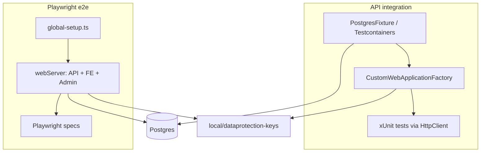

# Test architecture

How the two test layers are structured and how they interact with Postgres and DataProtection.

---

## Overview

| Concern | API integration | Playwright |
|---------|-----------------|------------|
| Host | In-process `WebApplicationFactory<Program>` | Real `dotnet run` + `npm run dev` |
| Database | Isolated DB per run (container or env string) | Dedicated local `baseproject_e2e` DB (auto create/reset) |
| Email | `CapturingEmailSender` (no SMTP) | N/A (UI only) |
| Auth token | HTTP responses / helper methods | Browser login helpers |
| Parallelism | xUnit collection fixture (shared factory) | `workers: 1` locally; 2 in CI |

---

## API integration layer

### Fixtures

| Type | Role |
|------|------|
| `PostgresFixture` | Starts Postgres 16 via Testcontainers when Docker is available; exposes connection string + ephemeral `DataProtectionKeysDirectory` |
| `IntegrationAppFixture` | Single `CustomWebApplicationFactory` per collection; runs migrations once |
| `IntegrationTestApp` | High-level HTTP helpers: register, verify email from sink, login, admin calls |

### CustomWebApplicationFactory

- Environment: **Development**
- Replaces `ApplicationDbContext` with test connection string
- Registers `CapturingEmailSender` instead of real email
- Seeds admin via config (`IntegrationTestApp.AdminEmail` / `AdminPassword`)
- Sets `DataProtection:KeysDirectory` to fixture directory (isolated from dev machine keys)
- Disables RabbitMQ (`Messaging:RabbitMq:Enabled=false`) unless media test opts in

### Test style

- Use `HttpClient` from factory; extension methods in `IntegrationHttpExtensions`
- Parse verification links from `CapturingEmailSender` via `EmailBodyParser`
- Prefer **one behavioral scenario per test**; reuse `IntegrationTestApp` for multi-step flows
- Admin mutations that need concurrency pass `rowVersion` from prior GET

---

## Playwright layer

### Config (`e2e/playwright.config.ts`)

- **Projects:** `frontend-setup` → `frontend`; standalone `admin`
- **webServer** (unless `E2E_SKIP_WEBSERVER=1`): starts API, Frontend, Admin in order
- API env: `ASPNETCORE_URLS`, `DataProtection__KeysDirectory=local/dataprotection-keys`, Postgres connection strings
- Frontend/Admin env: `API_PROXY_TARGET` points at `E2E_API_URL`

### global-setup.ts

Runs before web servers when not skipping:

1. Verifies Postgres TCP connectivity
2. Resets `TwoFactorSecret` and deletes bootstrap admin so API re-seeds with consistent keys

### Auth models (critical for UI tests)

| App | Token storage | Playwright strategy |
|-----|---------------|---------------------|
| Frontend | `localStorage` (`fp.auth.tokens`) | `frontend-setup` saves `storageState`; authenticated specs use `test.use({ storageState })` |
| Admin | Zustand in-memory `accessToken` | **Cannot** use `storageState`; call `loginAdminConsole()` in `beforeEach` |

This difference is a **product architecture** constraint, not a Playwright bug.

### Login helpers (`e2e/tests/helpers/login.ts`)

- Fill login form, click Sign in
- `waitForResponse` on `POST .../api/v1/auth/login` — surfaces API errors in test output
- Assert navigation: Frontend → `/app/`; Admin → not `/login`

---

## DataProtection and database state

Both layers assume Development seed admin and compatible encryption keys.

| Symptom | Cause | Fix |
|---------|-------|-----|
| Login 500, decryption exception | DB has secrets encrypted with other keys | Run `global-setup` reset SQL or delete user + clear `TwoFactorSecret` |
| Stale admin password | Manual DB edits | Delete seed user; restart API to re-seed |
| Testcontainers vs local DB drift | Different migration state | `./tools/backend/migrate.sh` on local DB |

See [`docs/backend/DATA_PROTECTION.md`](../backend/DATA_PROTECTION.md).

---

## Ports and proxies

| Service | Default port | Notes |
|---------|--------------|-------|
| API (e2e) | `5076` | macOS may reserve `5000` (AirPlay) |
| Frontend | `3000` | Proxies `/api` to `API_PROXY_TARGET` |
| Admin | `5174` | Vite dev server; proxies API similarly |

Playwright health checks hit `${E2E_API_URL}/health/live` before UI servers start.

---

## What not to test here

- Worker cron / queue processing end-to-end (use API integration with Rabbit disabled or dedicated worker tests later)
- Third-party SMTP delivery
- Production TLS certificates (dev servers use HTTP or local HTTPS profiles only when run manually)
